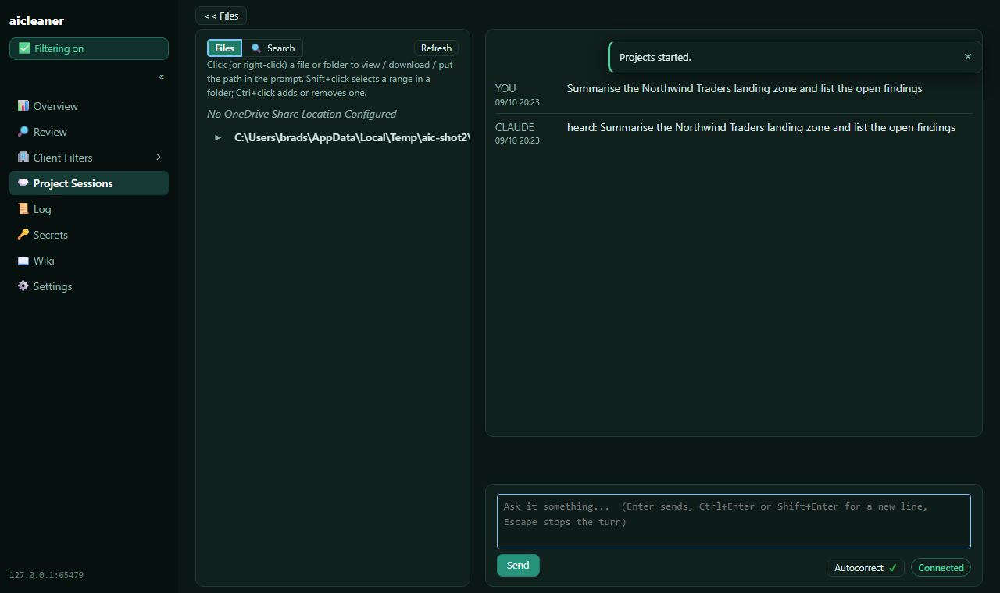

# aicleaner

**Use AI on client work without sending your clients' names to the AI provider.**

aicleaner runs on your own PC, between your AI tools (Claude Code, Claude Desktop) and the provider.
Before anything leaves, it swaps each client's names, domains, tenants, addresses and resource
names for neutral stand-ins; when the reply comes back, it puts the real names back. You work with
real names everywhere - files, terminals, git - and the provider only ever sees the stand-ins.

## Install

1. Download **`aicleaner-setup.zip`** from the [latest release](https://github.com/specul8/aicleaner/releases/latest).
2. Extract it anywhere and double-click **`Install aicleaner.cmd`**.
3. Answer a few questions; the setup page opens in your browser to finish.

Windows 10 or 11. No administrator rights needed for the usual install.

## Learn more

[What it does](docs/wiki/Introduction.md) ·
[Getting started](docs/wiki/Getting-started.md) ·
[How it works](docs/wiki/How-it-works.md) ·
[Security model](docs/wiki/Security-model.md) ·
[Remote access](docs/wiki/Remote-access.md) ·
[All wiki pages](docs/wiki/Home.md)

Built by [BIOS Consulting](https://biosconsulting.com.au). Licensed under the [MIT licence](LICENSE).
