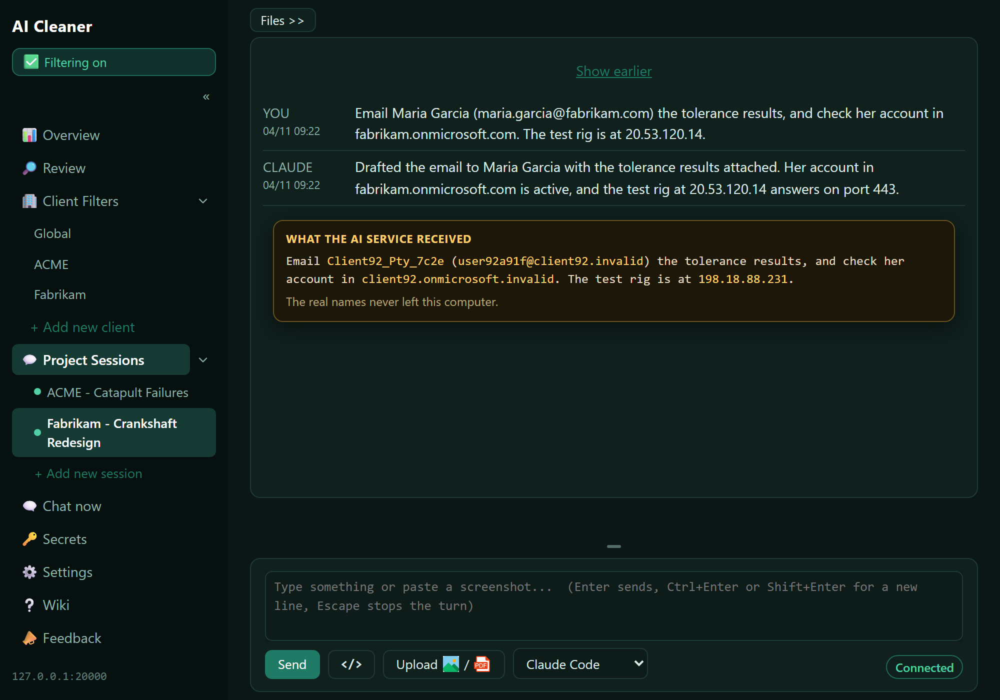

# AI Cleaner

**Use AI on client work without sending your clients' names to the AI service.**

A topic is anything whose names you keep out of AI services: a client, a product, a person.

AI Cleaner runs on your own PC, between your AI tools (Claude Code, Claude Desktop, GitHub Copilot) and the AI
service. Before anything leaves, it swaps each topic's names, people, domains, tenants, addresses and resource names
for neutral tokens; when the reply comes back, it puts the real terms back. You work with the real terms everywhere -
files, terminals, git - and the AI service only ever sees the tokens.

## Why do I need this?

Talk to your favourite AI service about clients the same way you talk to your work colleagues:

- use the client's name
- talk about the people who work there - names and email addresses
- paste URLs and public IP addresses
- work with their Microsoft tenancy - tenant names, SharePoint sites, IDs

...and the client-specific data never leaves your computer.

## How does it do that? Can I trust it?

- **Everything happens on your computer.** The engine is a local proxy on `127.0.0.1`; AI Cleaner has no cloud
  service of its own.
- **Known terms** - everything in your topics - are swapped for tokens in every request.
- **Learning mode is on by default.** A new email address, domain, Microsoft tenant, SharePoint site, Azure DevOps
  name or cloud resource name it has not seen before is held back as a token in the same request that first carries
  it, and queued for you to add to a topic. New IP addresses and GUIDs always get a token.
- **The canary** is a last check on every request: if a known real term is still in it, the request is stopped and
  nothing is sent.
- **Pictures, Word, Excel, PowerPoint and PDF files** are converted to text on your computer and filtered like
  anything else - or, for pictures and scanned PDFs, sent with names blacked out, as you choose.

What it cannot catch, said plainly:

- **A person's or company's name that is not in your topics** is flagged for you to review, not held back - holding
  back every capitalised phrase would garble ordinary text.
- **Text in a picture the reader cannot read** - handwriting, a logo, tiny or rotated text.
- **Any type of identifier you have set to Ignore** in Settings.

More: [How it works](docs/wiki/How-it-works.md) and the [Security model](docs/wiki/Security-model.md).

## Will it work for me?

- Windows 10 or 11.
- Claude Code (in VS Code, or in AI Cleaner's own Project Sessions page), Claude Desktop, or GitHub Copilot in VS Code.
- No administrator rights for the usual install. Setting up Claude Desktop asks for them once, for that step only.
- Not the AI services' phone apps: AI Cleaner does not protect conversations in the Claude, ChatGPT or Copilot apps on
  a phone. It does protect them when you use Project Sessions on a phone instead of the app, through remote access.
  The [Security model](docs/wiki/Security-model.md) lists which tools are filtered.

## How do I get it?

1. Download **`aicleaner-setup.zip`** from the [latest release](https://github.com/specul8/aicleaner/releases/latest).
2. Extract it anywhere and double-click **`Install aicleaner.cmd`**.
3. Answer a few questions; the setup page opens in your browser to finish.

Updates come from the same place: **Settings > Updates** in AI Cleaner checks for a newer release and installs it -
checking everything first, and putting the previous version back by itself if the new one does not start.

## Where do I learn more?

[What it does](docs/wiki/Introduction.md) ·
[Getting started](docs/wiki/Getting-started.md) ·
[How it works](docs/wiki/How-it-works.md) ·
[Security model](docs/wiki/Security-model.md) ·
[Remote access](docs/wiki/Remote-access.md) ·
[All wiki pages](docs/wiki/Home.md)

Questions, problems or ideas: [open an issue](https://github.com/specul8/aicleaner/issues), or use **Feedback**
in AI Cleaner's menu.

Built by [BIOS Consulting](https://biosconsulting.com.au). Licensed under the [MIT licence](LICENSE).
